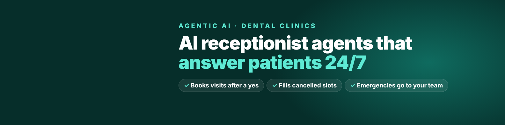

## Hi, I'm Ahmad 👋

I build **AI receptionist agents for dental clinics** with **n8n** and LLMs (OpenAI, Gemini, Claude).

My agents answer patients 24/7, offer real free slots, book only after the patient confirms, fill cancelled slots from a waitlist, and hand anything clinical to the team. They never give medical advice.

### What I build

- **AI front desk agents:** FAQs, bookings, waitlist offers, urgent handover to staff
- **WhatsApp AI bots:** customer support and order taking on the official WhatsApp Cloud API
- **Lead and outreach automation:** find leads, score websites, write personal email drafts, track replies
- **n8n workflows:** CRM sync, Gmail, Telegram, data tables, webhooks, error handling

### Projects

| Project | What it does |
|---|---|
| [dental-ai-receptionist](https://github.com/ahmadjutt092008-ahma/dental-ai-receptionist) | AI front desk for a sample dental clinic: booking, cancel → WhatsApp waitlist, safe handover, staff board (demo video inside) |
| [dental-website-audit-agent](https://github.com/ahmadjutt092008-ahma/dental-website-audit-agent) | Scans a clinic website for 8 front desk checks and builds a PDF audit report |
| [ai-customer-support-lead-system](https://github.com/ahmadjutt092008-ahma/ai-customer-support-lead-system) | Customer support and lead management with specialised n8n AI agents |

### Tools

`n8n` · `OpenAI` · `Gemini` · `Claude` · `MCP` · `WhatsApp Cloud API` · `Gmail` · `Telegram` · `Webhooks` · `JavaScript` · `JSON`

### How I work

1. Safety rules first: what the AI must never do
2. Real data only: real slots, real prices, the clinic's own answers
3. Test like a patient: book, cancel, emergency, edge cases
4. Hand over with a simple guide for the team

### Contact

- LinkedIn: [linkedin.com/in/ahmadhassan-n8n](https://www.linkedin.com/in/ahmadhassan-n8n/)
- Upwork: [AI receptionist for your clinic](https://www.upwork.com/freelancers/~01309eb2dd70ae1da7)
- Fiverr: [aiautobuilder](https://www.fiverr.com/aiautobuilder)

Free front desk audit for dental clinics: message me "audit" on LinkedIn.
